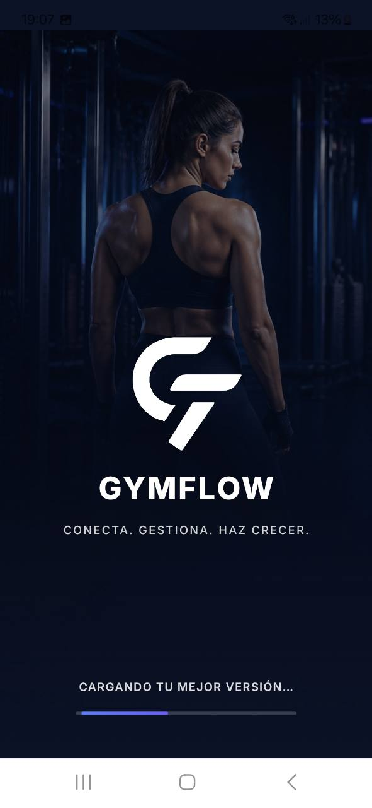
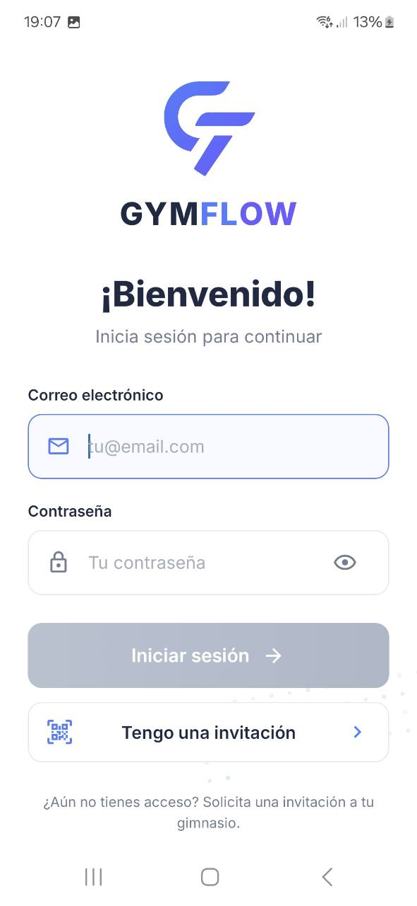
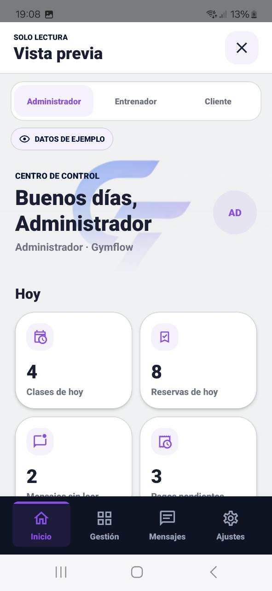
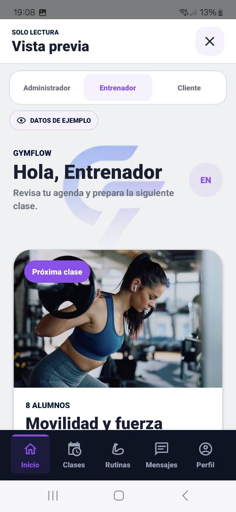
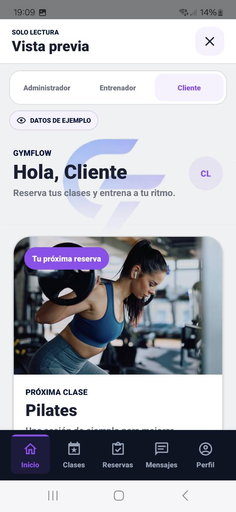
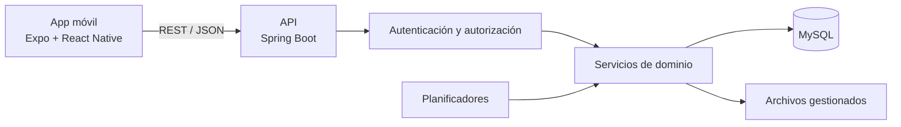

<p align="center">
  
</p>

<p align="center">
  <strong>Una plataforma para gestionar gimnasios y conectar a sus equipos y clientes.</strong>
</p>

<p align="center">
  
  
  
  
</p>

GymFlow reúne en una aplicación móvil las tareas diarias de un centro deportivo: clases y reservas, rutinas, pagos, comunicaciones, gestión de usuarios y configuración del gimnasio. La experiencia se adapta a los roles de **administrador**, **entrenador** y **cliente**.

> **Estado:** versión funcional de portfolio, actualmente en pausa planificada. No es un servicio desplegado para uso en producción.

## Experiencia móvil

<p align="center">
  
  &nbsp;&nbsp;
  
</p>

<p align="center"><em>Identidad del producto, acceso con credenciales e invitaciones al gimnasio.</em></p>

<p align="center">
  
  
  
</p>

<p align="center"><em>Paneles con información, navegación y acciones adaptadas a cada rol.</em></p>

Las capturas muestran datos de ejemplo y se centran en el acceso y los paneles principales.

## Funcionalidades

- Programación semanal de clases y creación de sesiones con identificadores estables.
- Reservas con límite de aforo y protección frente a solicitudes concurrentes por la última plaza.
- Rutinas de entrenamiento, biblioteca de ejercicios, asignaciones y cálculo de repetición máxima (1RM).
- Pagos con estados persistentes: pendiente, pagado y cancelado; el vencimiento se calcula.
- Comunicados, mensajes y automatizaciones con audiencias definidas.
- Gestión de clientes y entrenadores, además de invitaciones de clientes mediante enlace o QR.
- Carga controlada de imágenes y multimedia, con validación del tipo y del contenido.
- Identidad visual configurable y vistas diferenciadas para los tres roles.

## Arquitectura



La API deriva la identidad y el gimnasio de la sesión, y vuelve a comprobar el rol y la pertenencia antes de realizar operaciones. El backend separa controladores, servicios de dominio, repositorios y DTO.

Consulta la documentación para conocer los detalles:

- [Arquitectura](docs/architecture.md)
- [API REST](docs/api.md)
- [Decisiones técnicas](docs/technical-decisions.md)

## Tecnologías

| Área | Tecnologías |
| --- | --- |
| Aplicación móvil | React Native, Expo Router, TypeScript |
| API | Java 17, Spring Boot, Spring MVC, Spring Data JPA |
| Persistencia | MySQL; H2 para pruebas del backend |
| Calidad | JUnit, Mockito, Node Test Runner, TypeScript, ESLint |
| Automatización | GitHub Actions |

La integración continua ejecuta las comprobaciones de la aplicación móvil y las pruebas del backend en las solicitudes de cambio y en las actualizaciones de `main`.

## Ejecución local

### Requisitos

- Node.js 22 y npm.
- JDK 17.
- MySQL.

### 1. Configurar y arrancar el backend

Crea la base de datos `gymflow_db`, copia `application-example.properties` como `application.properties` y configura las variables de entorno indicadas en [backend/README.md](backend/README.md). El archivo de ejemplo contiene la configuración inicial.

Desde la raíz del repositorio:

```powershell
cd backend
Copy-Item src\main\resources\application-example.properties src\main\resources\application.properties
.\mvnw.cmd spring-boot:run
```

La API se sirve bajo `/api`.

### 2. Configurar y arrancar la aplicación

Sigue [mobile/README.md](mobile/README.md) para configurar `EXPO_PUBLIC_API_URL`. Debe incluir `/api`; para probar desde un dispositivo físico, usa la dirección local de red del equipo que ejecuta el backend.

```powershell
cd mobile
npm ci
npm start
```

## Estructura del repositorio

```text
gymwebsite/
├── backend/       # API REST y pruebas de backend
├── mobile/        # Aplicación Expo / React Native
├── docs/          # Arquitectura, API y decisiones técnicas
└── .github/       # Flujos de integración continua
```

## Configuración

| Variable | Ámbito | Descripción |
| --- | --- | --- |
| `DB_URL` | Backend | JDBC URL de MySQL (por defecto `jdbc:mysql://localhost:3306/gymflow_db`). |
| `DB_USERNAME` / `DB_PASSWORD` | Backend | Credenciales de la base de datos. |
| `GYMFLOW_AUTH_SECRET` | Backend | Secreto HMAC de sesión; mínimo 32 caracteres aleatorios por entorno. |
| `GYMFLOW_INVITATION_SECRET` | Backend | Secreto HMAC de invitaciones de clientes; mínimo 32 caracteres. |
| `GYMFLOW_CORS_ALLOWED_ORIGINS` | Backend | Orígenes permitidos separados por comas (p. ej. la URL de Expo). |
| `GYMFLOW_UPLOAD_DIR` | Backend | Carpeta de archivos subidos (por defecto `uploads`). |
| `EXPO_PUBLIC_API_URL` | Móvil | URL base de la API, incluyendo el sufijo `/api`. |

Copia `backend/src/main/resources/application-example.properties` a `application.properties` y `mobile/.env.example` a `.env` antes de arrancar en local.

## Pruebas

No ejecutes las comprobaciones como parte de un despliegue manual sin revisar el entorno; en el repositorio están definidas así:

```powershell
cd mobile
npm run check

cd ..\backend
.\mvnw.cmd test
```

GitHub Actions (`.github/workflows/ci.yml`) lanza estas mismas tareas en `main` y en pull requests.

## Despliegue

No hay Dockerfile ni scripts de producción en este repositorio: GymFlow es un proyecto de portfolio. Un despliegue real requeriría, como mínimo, MySQL gestionado, secretos distintos por entorno, CORS acorde al dominio de la app, almacenamiento persistente para `gymflow.upload-dir` y una build de la app móvil firmada para las tiendas o distribución interna.

## Contribución

1. Haz fork del repositorio y crea una rama con un nombre descriptivo.
2. Mantén commits pequeños y mensajes en imperativo que expliquen el cambio.
3. Abre un pull request contra `main` describiendo el alcance y cómo probarlo manualmente.

## Licencia

El código se distribuye bajo los términos del archivo [LICENSE](LICENSE) en la raíz del repositorio.

## Sobre el proyecto

GymFlow es un proyecto personal de aprendizaje y portfolio. Se desarrolló con apoyo de herramientas de IA generativa; la dirección del producto, sus decisiones y la revisión del trabajo corresponden a su autor.

Desarrollado por **Von Miller**. Consulta [LICENSE](LICENSE) antes de reutilizar el código.
